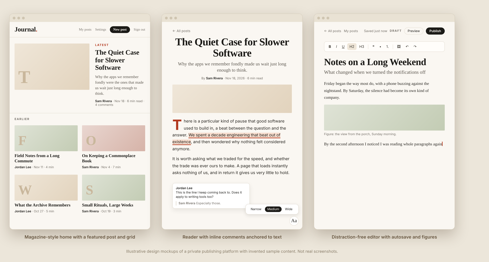
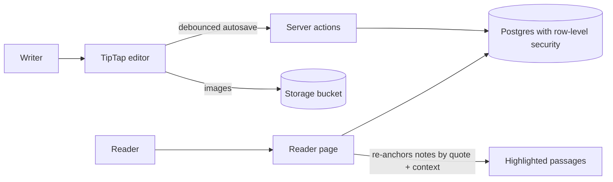

# Private publishing platform

**A private publishing platform for a small group of writers, with a rich-text editor, autosave, and comments anchored to specific passages.**

> 🔒 The source code is private. This repo describes the product and how it's built. The images below are **illustrative design mockups with invented sample content**, not real screenshots.

## What it is
This is a small, magazine-style publication I designed and built for a closed group of writers: write, publish, read and discuss. It's deliberately quiet and typographic, with a serif reading experience, an editor with nothing in the way, and discussion that happens next to the sentence it's about.

## Features
- **Rich-text editor** with headings, lists, quotes, code blocks, links, inline formatting, and embedded figures with captions.
- **Autosave** that never loses work: edits save about a second after you stop typing, saves never overlap, a failed save keeps your text and retries, and anything pending is flushed when you switch tabs, preview or publish.
- **Notes on the text.** Comments can point at specific highlighted passages in a post. The post itself is never modified. A note remembers the exact words (and a little surrounding text) and finds them again when the post is displayed.
- **Threaded replies** on every comment.
- **Drafts and publishing.** Drafts are visible only to their author. Published posts appear on a magazine-style home with a featured post and an "Earlier" grid.
- **Reader controls.** Readers choose their own column width (narrow, medium or wide).
- **Image uploads** for cover images and in-post figures, with type and size limits.
- **Accounts and settings,** including an editable display name.

## Tech stack
| Layer | Choice |
|---|---|
| Framework | Next.js 16 (App Router, server actions), React 19, TypeScript |
| Editor | TipTap (ProseMirror) |
| Backend & data | Supabase: Postgres, auth (cookie sessions via `@supabase/ssr`), Storage |
| UI | Tailwind CSS 4, editorial type system (display serif, text serif, UI sans) |

## Architecture

## Decisions I'm proud of
- **Security lives in the database.** Every table uses Postgres row-level security: anyone signed in can read published posts, but drafts are readable only by their author; you can only comment, edit or delete as yourself; and image uploads are allowed only into a folder named after your own user id. The app can't accidentally leak a draft, because the database won't return it.
- **Anchors that survive edits.** Instead of storing character offsets (which break the moment text changes), each note stores the quoted passage plus a few words either side and re-locates it at display time. The stored post HTML is never touched.
- **A save pipeline I can trust.** The autosaver is a small, framework-independent module: debounce, serialize, retry, flush. That makes the editor's most important promise easy to reason about.
- **Typography as a feature.** Reading is the whole point, so the type scale, drop caps, and reader-controlled measure were designed first.

## What I learned
The hard parts of a writing tool aren't the buttons. They're trust and state: knowing your words are safe, and that what you wrote and what others see stay consistent. Pushing access rules into row-level security, rather than scattering checks through the UI, made the whole app simpler to reason about.

## Status
Actively developed, private repo. Happy to walk through the code or a live demo on request.

---
Built by [@tunadahuman](https://github.com/tunadahuman)
